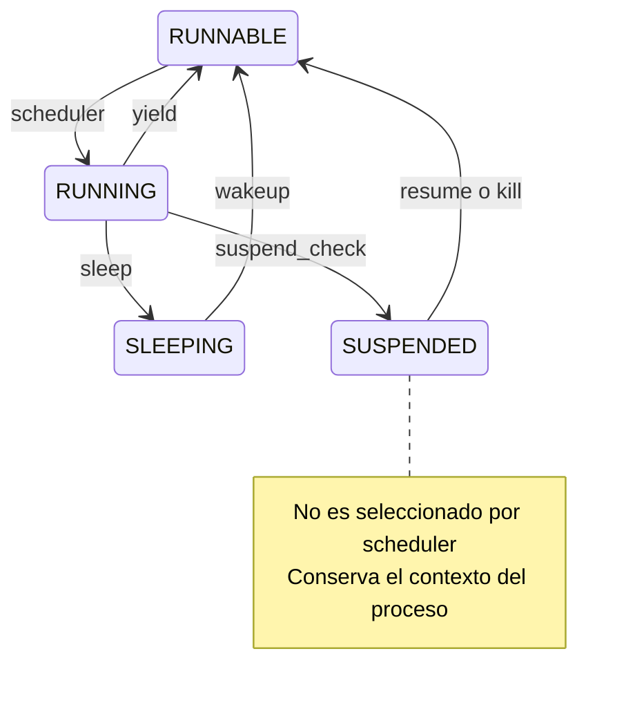
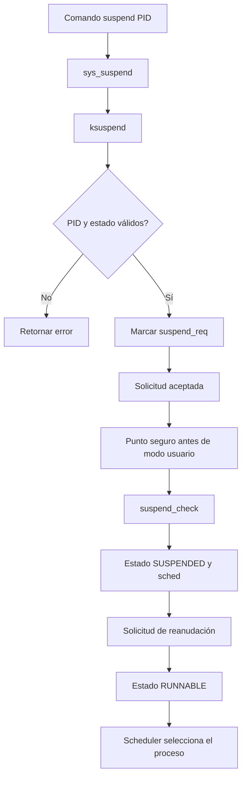

<div align="center">

# Suspensión y reanudación de procesos en xv6-RISC-V

**Diseño e implementación de un mecanismo de control de procesos por PID**


[](https://github.com/AndreeCode/xv6-final/actions/workflows/test.yml)

**Universidad Nacional de San Cristóbal de Huamanga**  
Escuela Profesional de Ingeniería de Sistemas  
IS-380 — Sistemas Operativos  
Docente: Ing. Lizbeth Jaico Quispe  
Ayacucho, Perú · 2026

[Instalación](#3-instalación) · [Compilación](#4-compilación) · [Ejecución](#5-ejecución) · [Pruebas](#8-pruebas-y-resultados)

</div>

---

## Índice

| Guía de instalación y uso | Documentación técnica |
| --- | --- |
| [1. Descripción del proyecto](#1-descripción-del-proyecto) | [7. Diseño e implementación](#7-diseño-e-implementación) |
| [2. Requisitos del sistema](#2-requisitos-del-sistema) | [8. Pruebas y resultados](#8-pruebas-y-resultados) |
| [3. Instalación](#3-instalación) | [9. Estructura del repositorio](#9-estructura-del-repositorio) |
| [4. Compilación](#4-compilación) | [10. Integración continua](#10-integración-continua) |
| [5. Ejecución](#5-ejecución) | [11. Solución de problemas](#11-solución-de-problemas) |
| [6. Manual de usuario](#6-manual-de-usuario) | [12. Limitaciones y mejoras futuras](#12-limitaciones-y-mejoras-futuras) |
| | [13. Equipo de desarrollo](#13-equipo-de-desarrollo) |
| | [14. Conclusiones](#14-conclusiones) |
| | [15. Referencias y licencia](#15-referencias-y-licencia) |

---

## 1. Descripción del proyecto

### 1.1. Contexto y problema

xv6-RISC-V es un sistema operativo educativo de tipo Unix desarrollado por el MIT para estudiar el funcionamiento del núcleo, la administración de memoria, las llamadas al sistema y la planificación de procesos.

La versión original no dispone de una operación explícita para suspender temporalmente un proceso y continuar posteriormente su ejecución. Los estados existentes permiten representar procesos listos, en ejecución, dormidos o terminados, pero no una pausa solicitada por otro proceso que se mantenga hasta que se ordene su reanudación.

### 1.2. Solución propuesta

El proyecto amplía la administración de procesos de xv6 mediante el estado `SUSPENDED`, el campo de control `suspend_req` y tres nuevas llamadas al sistema. La suspensión se solicita utilizando el identificador del proceso (PID) y se aplica de forma diferida en un punto seguro antes del retorno a modo usuario. La reanudación permite que el proceso vuelva a competir por la CPU sin reiniciar su programa ni perder su contexto.

| Aspecto | xv6 original | xv6 modificado |
| --- | --- | --- |
| Estados de proceso | 6 | 7, con `SUSPENDED` |
| Suspensión explícita | No disponible | `suspend(pid)` |
| Reanudación explícita | No disponible | `resume(pid)` |
| Consulta de estado por syscall | No disponible | `pstate(pid)` |
| Planificador | Selecciona procesos `RUNNABLE` | Conserva el mismo criterio |
| Pruebas específicas de suspensión | No disponibles | 8 casos en `suspendtest` |

### 1.3. Objetivos

**Objetivo general:** diseñar, implementar y evaluar un mecanismo de suspensión y reanudación de procesos por PID en xv6-RISC-V.

**Objetivos específicos:**

- Incorporar el estado `SUSPENDED` y validar las transiciones correspondientes.
- Implementar la suspensión diferida para evitar detener procesos en medio de operaciones críticas del núcleo.
- Integrar la reanudación con el planificador existente.
- Exponer las operaciones mediante llamadas al sistema y programas de usuario.
- Evaluar el comportamiento mediante pruebas de integración y demostraciones en QEMU.

### 1.4. Funcionalidades principales

| Funcionalidad | Comportamiento |
| --- | --- |
| Suspensión por PID | Solicita detener temporalmente el proceso identificado. |
| Reanudación por PID | Devuelve un proceso suspendido a `RUNNABLE` o cancela una solicitud pendiente. |
| Consulta de estado | Permite conocer el estado actual de un PID. |
| Protección de `init` | Impide suspender el proceso inicial del sistema. |
| Validación de operaciones | Devuelve códigos de error cuando la solicitud no es válida. |
| Sincronización | Protege los cambios de estado mediante el lock de cada proceso. |
| Demostración | Incluye un contador interactivo (`spin`) y una batería de pruebas (`suspendtest`). |

## 2. Requisitos del sistema

### 2.1. Entorno recomendado

Se recomienda Ubuntu 24.04 LTS o una distribución Debian/Ubuntu que disponga de QEMU 7.2 o posterior. En Windows se recomienda WSL2 con Ubuntu. La compilación en macOS también se contempla en el workflow del repositorio; la ejecución en ese entorno requiere instalar QEMU y las demás herramientas necesarias.

### 2.2. Dependencias

| Herramienta | Requisito | Finalidad |
| --- | --- | --- |
| Git | Para descargar el código | Control de versiones y clonación |
| GNU Make | Obligatorio | Automatizar la construcción y ejecución |
| GCC nativo y utilidades de compilación | Obligatorio | Construir `mkfs` en el anfitrión |
| GCC y binutils RISC-V de 64 bits | Obligatorio | Compilar, enlazar e inspeccionar el núcleo y los programas de usuario |
| Perl | Obligatorio | Generar los stubs de llamadas al sistema |
| QEMU (`qemu-system-riscv64`) | Versión mínima 7.2 para ejecutar | Emular la máquina RISC-V |
| `bc` | Para `make qemu` | Comprobar la versión del emulador |
| Python 3 | Para pruebas adicionales | Ejecutar `test-xv6.py` |
| `clang-format` | Para control de formato | Ejecutar la verificación de estilo de CI |

El [Makefile](Makefile) reconoce varios prefijos de herramientas RISC-V, entre ellos `riscv64-linux-gnu-`, `riscv64-unknown-elf-` y `riscv64-elf-`. No se necesita una computadora física RISC-V: QEMU emula la arquitectura.

## 3. Instalación

### 3.1. Ubuntu / Debian

**Paso 1.** Actualizar el índice de paquetes.

```bash
sudo apt update
```

**Paso 2.** Instalar las herramientas de desarrollo y el emulador.

```bash
sudo apt install -y git build-essential gcc-riscv64-linux-gnu \
  binutils-riscv64-linux-gnu qemu-system-riscv perl bc
```

**Paso 3.** Instalar las herramientas adicionales de pruebas y formato.

```bash
sudo apt install -y python3 clang-format
```

**Paso 4.** Verificar que las herramientas estén disponibles.

```bash
git --version
make --version
riscv64-linux-gnu-gcc --version
qemu-system-riscv64 --version
perl --version
```

> [!IMPORTANT]
> Si QEMU es anterior a 7.2, utilizar una distribución o instalación compatible. No se recomienda desactivar la comprobación de versión del Makefile.

### 3.2. Windows mediante WSL2

Si WSL2 y Ubuntu ya están instalados, continuar directamente con los comandos del apartado 3.1 en la terminal de Ubuntu.

En caso contrario, abrir PowerShell con permisos de administrador y ejecutar:

```powershell
wsl --install -d Ubuntu
```

Reiniciar si Windows lo solicita y completar la configuración inicial de Ubuntu. Comprobar la versión de WSL desde PowerShell:

```powershell
wsl -l -v
```

Abrir Ubuntu e instalar las dependencias siguiendo el apartado 3.1. Se recomienda clonar el repositorio dentro del sistema de archivos de Linux (por ejemplo, `~/proyectos`) para facilitar la compilación.

### 3.3. macOS (compilación alternativa)

El workflow del proyecto instala la cadena cruzada con Homebrew:

```bash
brew install riscv64-elf-gcc
```

Para reproducir también la ejecución interactiva se requieren, entre otras herramientas, QEMU compatible y las utilidades usadas por el Makefile. Con Homebrew disponible, una instalación a verificar en el equipo es:

```bash
brew install qemu make bc
```

Si se necesita GNU Make instalado por Homebrew, usar `gmake` en lugar de `make`. Comprobar las versiones antes de continuar. La ejecución en macOS no forma parte de las evidencias del informe y esta ruta no se ha probado aquí.

### 3.4. Clonar el repositorio

Desde la terminal del entorno de desarrollo:

```bash
git clone https://github.com/AndreeCode/xv6-final.git
cd xv6-final
```

Comprobar la ubicación y la rama:

```bash
pwd
ls
git status
```

La raíz debe contener `Makefile`, `kernel/`, `user/` y `mkfs/`. Si el proyecto ya está clonado, basta con abrir su carpeta; no es necesario volver a clonarlo.

## 4. Compilación

Ejecutar los siguientes comandos desde la raíz del repositorio, en Linux o WSL2.

### 4.1. Limpiar la compilación anterior

```bash
make clean
```

Elimina los productos generados en compilaciones anteriores, incluida `fs.img`. Los archivos fuente no se eliminan, pero se perderá el contenido creado dentro de esa imagen de disco de xv6. Guardar cualquier información necesaria antes de limpiar.

### 4.2. Compilar el núcleo y la imagen de disco

```bash
make kernel/kernel fs.img
```

| Producto generado | Descripción |
| --- | --- |
| `kernel/kernel` | Ejecutable del núcleo para RISC-V. |
| `fs.img` | Imagen del sistema de archivos de xv6. |
| `mkfs/mkfs` | Herramienta anfitriona que construye `fs.img`. |
| `user/usys.S` | Stubs generados a partir de `user/usys.pl`. |
| `user/_suspend`, `user/_resume`, `user/_pstate` | Ejecutables de las operaciones de control de procesos. |
| `user/_spin`, `user/_suspendtest` | Ejecutables de demostración y pruebas. |

Comprobar que los dos productos principales existan:

```bash
ls -lh kernel/kernel fs.img
```

> [!NOTE]
> `make qemu` también construye automáticamente los productos necesarios antes de arrancar el emulador. La compilación separada facilita localizar errores antes de la ejecución.

## 5. Ejecución

### 5.1. Iniciar xv6 en QEMU

```bash
make qemu
```

La configuración predeterminada del repositorio utiliza tres CPU virtuales y 128 MiB de memoria. QEMU inicia el núcleo y presenta el shell de xv6 en la misma terminal.

**Salida orientativa de arranque** (el orden de los mensajes puede variar):

```text
xv6 kernel is booting
hart 1 starting
hart 2 starting
init: starting sh
$
```

El símbolo `$` indica que ya se pueden introducir los comandos propios de xv6. No debe escribirse como parte de los comandos.

### 5.2. Ejecutar con una cantidad diferente de CPU

```bash
make qemu CPUS=1
```

O, en otra ejecución:

```bash
make qemu CPUS=3
```

Las pruebas registradas en el informe técnico se realizaron con tres CPU. Se recomienda repetirlas con una CPU para comparar el comportamiento.

### 5.3. Salir del emulador

Presionar `Ctrl+A`, soltar las teclas y luego presionar `X`. Se regresará a la terminal anfitriona.

> [!TIP]
> Los comandos `make`, `git` y `apt` se ejecutan en el anfitrión. Los comandos `suspend`, `resume`, `pstate`, `spin` y `suspendtest` de este proyecto se ejecutan dentro del shell de xv6.

## 6. Manual de usuario

### 6.1. Comandos disponibles

| Comando en xv6 | Descripción | Ejemplo |
| --- | --- | --- |
| `spin &` | Inicia un contador en segundo plano. | `spin &` |
| `pstate` | Consulta los PID del 1 al 199 y muestra los existentes. | `pstate` |
| `pstate PID` | Consulta el estado de un proceso. | `pstate 4` |
| `pstate PID1 PID2` | Consulta varios PID explícitos. | `pstate 1 4` |
| `suspend PID` | Solicita la suspensión. | `suspend 4` |
| `resume PID` | Reanuda o cancela la suspensión pendiente. | `resume 4` |
| `suspendtest` | Ejecuta las ocho pruebas de integración. | `suspendtest` |
| `kill PID` | Solicita la terminación del proceso de demostración. | `kill 4` |
| `Ctrl+P` | Muestra la tabla de procesos del núcleo (`procdump`). | Atajo de teclado |

### 6.2. Demostración completa de suspensión y reanudación

La demostración siguiente se realiza exclusivamente dentro del xv6 emulado.

**Paso 1 — Crear el proceso de prueba.**

```text
spin &
```

El programa imprime un contador periódicamente. El operador `&` permite continuar utilizando el shell mientras se ejecuta el proceso.

**Paso 2 — Identificar el PID.**

```text
pstate
```

También se puede presionar `Ctrl+P` para identificar el proceso por su nombre `spin`. En el informe se utilizó el PID 4.

> [!IMPORTANT]
> El PID es dinámico. Sustituir el número 4 de los pasos siguientes por el PID real del proceso `spin` creado en esta ejecución. No utilizar el PID de `init` ni el del shell.

**Paso 3 — Solicitar la suspensión.**

```text
suspend 4
```

La solicitud debe aceptarse si el proceso y su estado son válidos. Esto no significa necesariamente que la suspensión ya se haya aplicado.

**Paso 4 — Verificar el estado.**

```text
pstate 4
```

Salida ilustrativa una vez alcanzado el punto seguro:

```text
PID     ESTADO
4       suspended
```

Si todavía aparece `sleeping`, esperar a que el proceso despierte y repetir la consulta. Una vez suspendido, el contador deja de avanzar. `Ctrl+P` permite confirmar el estado abreviado `susp`.

**Paso 5 — Reanudar el proceso.**

```text
resume 4
```

El proceso vuelve a estar disponible para la planificación y el contador continúa desde el valor conservado. Al consultar nuevamente su estado puede aparecer `runnable`, `running` o `sleeping`, según el instante en que se realice la consulta.

**Paso 6 — Finalizar la demostración.**

```text
kill 4
```

Comprobar que el contador se detenga y que el proceso desaparezca de la tabla después de que su terminación sea procesada.

### 6.3. Flujo de la demostración


## 7. Diseño e implementación

### 7.1. Modelo de estados

| Valor | Estado | Significado |
| ---: | --- | --- |
| 0 | `UNUSED` | Entrada de la tabla sin utilizar. |
| 1 | `USED` | Entrada asignada a un proceso. |
| 2 | `SLEEPING` | Proceso en espera de un evento. |
| 3 | `RUNNABLE` | Proceso listo para usar la CPU. |
| 4 | `RUNNING` | Proceso que se está ejecutando. |
| 5 | `ZOMBIE` | Proceso terminado pendiente de recolección. |
| 6 | **`SUSPENDED`** | Proceso detenido temporalmente por el mecanismo añadido. |

Los valores corresponden al orden del `enum procstate` en [kernel/proc.h](kernel/proc.h).

### 7.2. Diagrama de transiciones relevantes



El diagrama representa las transiciones relacionadas con la extensión; no pretende mostrar todo el ciclo de vida de un proceso en xv6.

### 7.3. Suspensión diferida

El campo `suspend_req` indica si existe una solicitud de suspensión pendiente o activa. `ksuspend()` valida el PID y el estado y registra la solicitud. El proceso alcanza `suspend_check()` desde los puntos previstos de retorno a modo usuario, en `usertrap()` o `forkret()`, donde puede cambiar de estado de manera segura. El lock del proceso protege la transición y el cambio de contexto.



El recorrido muestra una suspensión que llega a aplicarse; una solicitud pendiente también puede cancelarse con `resume()` antes de alcanzar el punto seguro.

### 7.4. Reanudación y planificación

`kresume()` valida la solicitud y, si el proceso está suspendido, lo devuelve al estado `RUNNABLE`. Si la suspensión está pendiente, la cancela sin forzar el cambio de un proceso dormido a listo. El planificador conserva su criterio original y selecciona únicamente procesos `RUNNABLE`, por lo que no necesita un algoritmo nuevo para omitir los suspendidos.

### 7.5. Sincronización y situaciones especiales

| Situación | Tratamiento implementado |
| --- | --- |
| Acceso concurrente a la estructura de proceso | Uso de `p->lock` para proteger la actualización de estado. |
| Proceso dormido con suspensión solicitada | Permanece dormido hasta despertar; la suspensión puede quedar pendiente. |
| Proceso recién creado | Se considera el punto seguro de `forkret()`. |
| Suspensión duplicada | Se rechaza mediante validación de la solicitud previa. |
| Terminación de un proceso suspendido | `kkill()` permite que vuelva a ejecutarse para completar su salida. |
| Intento de suspender `init` | Se rechaza para preservar el proceso inicial. |

### 7.6. Llamadas al sistema

| Interfaz | Parámetro | Retorno |
| --- | --- | --- |
| `suspend(pid)` | Identificador del proceso | 0 al aceptar la solicitud; código negativo si falla. |
| `resume(pid)` | Identificador del proceso | 0 si reanuda o cancela la solicitud; código negativo si falla. |
| `pstate(pid)` | Identificador del proceso | Valor de `enum procstate`; -1 si no existe. |

Las llamadas pasan desde los programas de usuario por los stubs generados en `user/usys.pl` hacia el despacho de llamadas en `kernel/syscall.c` y los manejadores correspondientes de `kernel/sysproc.c`.

### 7.7. Códigos de retorno

| Constante | Valor | Significado |
| --- | ---: | --- |
| `SUSP_OK` | 0 | Operación aceptada. |
| `SUSP_ENOPROC` | -1 | PID inexistente. |
| `SUSP_EINIT` | -2 | No se permite suspender `init`. |
| `SUSP_EKILLED` | -3 | Proceso marcado para terminar. |
| `SUSP_EALREADY` | -4 | Suspensión activa o pendiente. |
| `SUSP_ESTATE` | -5 | Estado incompatible con la operación. |
| `SUSP_ENOTSUSP` | -6 | No hay suspensión que reanudar. |

Las constantes se encuentran en [kernel/proc.h](kernel/proc.h). Un retorno exitoso de `suspend()` indica que la petición se aceptó, no que el proceso ya esté en `SUSPENDED`.

### 7.8. Comparación con Linux

| Concepto | xv6 modificado | Linux |
| --- | --- | --- |
| Detención | `suspend(pid)` | Señal `SIGSTOP` |
| Continuación | `resume(pid)` | Señal `SIGCONT` |
| Estado detenido | `SUSPENDED` | `TASK_STOPPED` |
| Consulta | `pstate` | `ps` o información en `/proc` |
| Interfaz | Llamadas dedicadas | Subsistema de señales |

La comparación es conceptual. La extensión educativa no reproduce todo el control de trabajos, el modelo de permisos ni las notificaciones a procesos padres de Linux.

## 8. Pruebas y resultados

### 8.1. Ejecutar la batería automática

Después de iniciar QEMU con `make qemu`, ejecutar dentro de xv6:

```text
suspendtest
```

El programa [user/suspendtest.c](user/suspendtest.c) crea procesos hijos, verifica sus estados y códigos de retorno, y finaliza los procesos de prueba.

### 8.2. Matriz de casos de prueba

| ID | Escenario | Comprobación esperada | Informe del equipo |
| --- | --- | --- | --- |
| CP-01 | Suspender un hijo en ejecución | `pstate(pid)` devuelve 6 | OK |
| CP-02 | Reanudar el hijo suspendido | Estado `RUNNABLE` o `RUNNING` | OK |
| CP-03 | Solicitar suspensión dos veces | La segunda solicitud devuelve -4 | OK |
| CP-04 | Intentar suspender `init` | Devuelve -2 | OK |
| CP-05 | Consultar, suspender y reanudar un PID inexistente | Las tres llamadas devuelven -1 | OK |
| CP-06 | Reanudar un hijo no suspendido | Devuelve -6 | OK |
| CP-07 | Terminar un hijo suspendido | `wait()` devuelve el PID del hijo | OK |
| CP-08 | Solicitar suspensión de un hijo dormido y cancelarla | Permanece `SLEEPING` y `resume()` devuelve 0 | OK |

### 8.3. Resultado registrado

| Entorno | Pruebas | Aprobadas | Fallidas |
| --- | ---: | ---: | ---: |
| QEMU RISC-V, 3 CPU | 8 | 8 | 0 |

```text
8 OK, 0 FAIL
```

Fuente: informe técnico del equipo, capítulo IV, sección 4.2.1, figura 6. Se trata del resultado registrado en el informe, no de una nueva ejecución de pruebas durante la elaboración de este README.

### 8.4. Pruebas manuales de validación

Además de la demostración del apartado 6, el informe documenta casos negativos. En una sesión nueva de xv6, comprobar que los PID de ejemplo realmente no existan o correspondan a los procesos indicados antes de usarlos.

| Entrada en xv6 | Resultado esperado |
| --- | --- |
| `suspend 1` | Error -2: `init` protegido. |
| `suspend 9999` | Error -1 si el PID no existe. |
| `suspend abc` | Argumento inválido rechazado. |
| `resume PID` sobre un proceso no suspendido | Error -6. |
| `pstate PID` después de suspender `spin` | Estado `suspended` tras alcanzar el punto seguro. |
| `resume PID` sobre `spin` suspendido | El contador continúa su ejecución. |

### 8.5. Evidencias del informe técnico

| Evidencia | Referencia en el informe | Qué demuestra |
| --- | --- | --- |
| Arranque de xv6 | Figura 5 | Construcción del núcleo e inicio del shell. |
| Pruebas automáticas | Figura 6 | Resultado histórico de ocho pruebas satisfactorias. |
| Demostración con `spin` | Figura 7 | Suspensión, consulta de estado y reanudación. |
| Validaciones negativas | Figura 8 | Rechazo de operaciones inválidas. |

Las referencias corresponden al informe proporcionado por el equipo. No se insertan imágenes ni enlaces relativos a evidencias que no estén confirmados en el repositorio público.

## 9. Estructura del repositorio

Árbol resumido de los archivos relevantes para la extensión:

```text
xv6-final/
├── .github/
│   └── workflows/
│       └── test.yml
├── kernel/
│   ├── proc.h
│   ├── proc.c
│   ├── trap.c
│   ├── defs.h
│   ├── syscall.h
│   ├── syscall.c
│   └── sysproc.c
├── user/
│   ├── user.h
│   ├── usys.pl
│   ├── suspend.c
│   ├── resume.c
│   ├── pstate.c
│   ├── spin.c
│   └── suspendtest.c
├── mkfs/
├── .clang-format
├── Makefile
├── test-xv6.py
├── LICENSE
├── README
└── README.md
```

| Archivo o directorio | Responsabilidad |
| --- | --- |
| [kernel/proc.h](kernel/proc.h) | Estados, estructura de procesos y códigos de retorno. |
| [kernel/proc.c](kernel/proc.c) | Solicitud de suspensión, reanudación, consulta y transiciones. |
| [kernel/trap.c](kernel/trap.c) | Punto de integración antes del retorno a modo usuario. |
| [kernel/defs.h](kernel/defs.h) | Declaraciones de funciones del núcleo. |
| [kernel/syscall.h](kernel/syscall.h) y [syscall.c](kernel/syscall.c) | Identificadores y despacho de llamadas al sistema. |
| [kernel/sysproc.c](kernel/sysproc.c) | Manejadores de llamadas relacionadas con procesos. |
| [user/user.h](user/user.h) y [user/usys.pl](user/usys.pl) | Interfaz de las syscalls para programas de usuario. |
| [user/suspend.c](user/suspend.c), [user/resume.c](user/resume.c), [user/pstate.c](user/pstate.c) | Comandos para interactuar con el mecanismo. |
| [user/spin.c](user/spin.c) y [user/suspendtest.c](user/suspendtest.c) | Demostración y pruebas. |
| [Makefile](Makefile) | Compilación, creación de la imagen y ejecución en QEMU. |
| [test-xv6.py](test-xv6.py) | Pruebas adicionales del proyecto xv6. |
| [README](README) | Documentación original de xv6, incluida en `fs.img`. |

## 10. Integración continua

El repositorio incluye un [workflow de GitHub Actions](.github/workflows/test.yml) activado por eventos `push` y `pull_request`.

| Entorno | Verificaciones configuradas |
| --- | --- |
| Linux | Instalación de dependencias, control de formato, compilación del núcleo y disco, pruebas `usertests` y `crash`. |
| macOS | Instalación de la cadena RISC-V y compilación del núcleo y disco. |

La ejecución manual de `suspendtest` dentro de QEMU es complementaria: el workflow consultado no la invoca explícitamente como una etapa independiente.

Para comprobar el formato localmente, partir de un árbol de trabajo limpio y ejecutar:

```bash
make fmt
git diff --exit-code
```

Si el formateador cambia los archivos, `git diff --exit-code` devuelve 1. Revisar las diferencias con `git diff` antes de registrar la corrección. No desactivar las verificaciones para ocultar un fallo.

El estado actual de las comprobaciones puede consultarse en [GitHub Actions](https://github.com/AndreeCode/xv6-final/actions). El badge de la portada muestra el estado dinámico del workflow; no equivale a una certificación de todas las pruebas manuales.

## 11. Solución de problemas

| Problema | Posible causa | Acción recomendada |
| --- | --- | --- |
| `make: command not found` | GNU Make no instalado. | Instalar `build-essential` en Ubuntu. |
| No se encuentra GCC/binutils RISC-V | Cadena cruzada ausente o fuera de `PATH`. | Comprobar `riscv64-linux-gnu-gcc --version` e instalar las dependencias. |
| QEMU no se encuentra | Emulador ausente. | Instalar `qemu-system-riscv` y verificar su versión. |
| Error de versión de QEMU | Versión anterior a 7.2. | Actualizar el entorno a una versión compatible. |
| `suspend` o `pstate` no reconocido | Comando escrito fuera de xv6 o imagen antigua. | Entrar a xv6 y verificar la compilación de `fs.img`. |
| `pstate` muestra `sleeping` tras solicitar suspensión | Solicitud todavía pendiente. | Esperar el despertar y consultar nuevamente. |
| No aparece un PID mayor o igual a 200 con `pstate` | Límite del listado sin argumentos. | Consultar explícitamente ese PID o utilizar `Ctrl+P`. |
| Falla `make fmt && git diff --exit-code` | Diferencias de formato o cambios sin registrar. | Revisar el diff y usar una versión de clang-format compatible con CI. |

## 12. Limitaciones y mejoras futuras

### 12.1. Limitaciones actuales

- La suspensión es diferida: el proceso debe alcanzar el punto seguro previsto.
- `pstate(pid)` devuelve el estado, pero no distingue por sí solo una solicitud pendiente.
- `pstate` sin argumentos consulta únicamente los PID del 1 al 199.
- No se implementa un modelo de permisos de usuarios para autorizar la suspensión.
- No se notifica al proceso padre de los cambios de suspensión como en un control de trabajos completo.
- Las salidas del shell y de los procesos concurrentes pueden mezclarse en la consola.

### 12.2. Trabajo futuro

- Ampliar la consulta para mostrar solicitudes pendientes y todos los procesos activos.
- Incorporar pruebas adicionales con distintas cantidades de CPU.
- Evaluar una notificación al proceso padre cuando cambie el estado de suspensión.
- Implementar herramientas de monitoreo de procesos y métricas de comportamiento.
- Integrar una etapa explícita de `suspendtest` en la automatización, previa coordinación del equipo.

## 13. Equipo de desarrollo

| Integrante | Responsabilidad según el informe técnico |
| --- | --- |
| Apaico Paucca, Andree Phol | Consulta de estado, programas de prueba, demostración y documentación. |
| Flores Callañaupa, Juan Diego | Incorporación de `SUSPENDED`, inicialización y validación de transiciones. |
| Huarcaya Laura, Richard Beckham | Reanudación, integración con el planificador y llamadas `suspend`/`resume`. |
| Tanta Chala, Maks Brayan | Suspensión por PID e integración con `trap.c`. |

La distribución se reproduce del apartado 3.3.2 del informe del equipo; no se atribuyen aportes adicionales sin verificar el historial individual de commits.

## 14. Conclusiones

La extensión añade un mecanismo de control temporal de procesos al xv6 original manteniendo su criterio de planificación. La suspensión diferida, la validación de transiciones y la sincronización permiten estudiar cómo coordinar cambios de estado y llamadas al sistema en un núcleo educativo.

Los resultados documentados por el equipo (ocho pruebas automáticas satisfactorias y demostraciones manuales) respaldan el comportamiento observado en QEMU. El proyecto ofrece una base para estudiar mecanismos de control de procesos y ampliar posteriormente su cobertura de pruebas y monitoreo.

## 15. Referencias y licencia

- MIT PDOS. [Código fuente original de xv6-riscv](https://github.com/mit-pdos/xv6-riscv).
- MIT. [Curso Operating System Engineering (6.1810)](https://pdos.csail.mit.edu/6.1810/).
- Arpaci-Dusseau, R. H. y Arpaci-Dusseau, A. C. [Operating Systems: Three Easy Pieces](https://pages.cs.wisc.edu/~remzi/OSTEP/).
- QEMU. [Documentación oficial](https://www.qemu.org/docs/master/).
- Linux man-pages. [signal(7)](https://man7.org/linux/man-pages/man7/signal.7.html).
- Equipo del proyecto (2026). *Informe técnico: Diseño e implementación de mecanismos de suspensión y reanudación de procesos en xv6-riscv*. UNSCH. Fuente de objetivos, evidencias, resultados y distribución del trabajo.

Este proyecto es una extensión académica de xv6-RISC-V. Se mantienen los créditos y términos del software original. Consultar [LICENSE](LICENSE) y la [documentación original](README).

---

<div align="center">

**UNSCH · Escuela Profesional de Ingeniería de Sistemas**  
IS-380 Sistemas Operativos · Ayacucho, Perú · 2026

</div>
